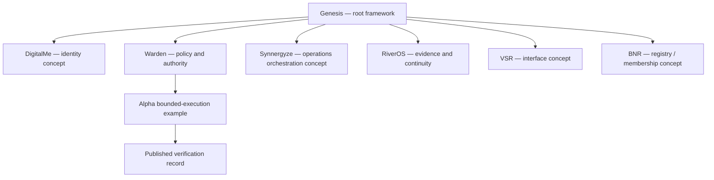

# GENESIS / ARK

**A network of possibility. A system of trust.**

[Explore the Gateway prototype](gateway/README.md) · [Browse the engineering stack](#explore-the-engineering-stack) · [Read the evidence](#verification-and-assurance) · [Contribute](#how-to-participate)

> **Public engineering registry for the Virtual Silk Road and Genesis Stack.** This repository contains reference architecture, bounded implementations, specifications and verification records. It is **not** an unrestricted execution endpoint, a live membership registry or proof that the entire ecosystem has been deployed.

---

## Welcome to the living gateway

The Genesis ecosystem is easier to understand when you can explore it through the responsibility you hold. Our new **[Gateway R0.1 prototype](gateway/README.md)** is a responsive, interactive front-end proposal with paths for developers, prospective members, operators and auditors.

| Explore | Understand | Verify |
|:--|:--|:--|
| [Interactive system atlas](gateway/README.md) | [Knowledge Hub architecture](docs/knowledge-hub-proxy.md) | [Engineering verification record](docs/evidence/GES-ALPHA-CONTROL-PLANE-R0.1.md) |
| [Engineering catalogue](gateway/README.md) | [Alpha control plane](control-plane/README.md) | [Warden stability gate](docs/evidence/WARDEN-STABILITY-GATE-R0.1.md) |
| [LBM / OCM interactive guide](gateway/README.md) | [Smart Textile Product Passports](smart-textiles/README.md) | [CI workflows](.github/workflows) |

**Try the experience locally:**

```sh
python -m http.server 8080 --directory gateway
# Visit http://localhost:8080
```

The Gateway lives in `gateway/` and remains an **undepoyed static prototype** until a separately authorised preview release. No live authentication, membership provisioning or privileged execution is available from that interface.

## Explore the engineering stack

<details open>
<summary><strong>01 — Engineering Station Alpha Control Plane</strong> · bounded execution</summary>

The first governed execution slice for `GES-ALPHA-001` lives under [control-plane/](control-plane/).

- [Design specification](docs/superpowers/specs/2026-09-09-genesis-engineering-station-alpha-design.md)
- [Implementation plan](docs/superpowers/plans/2026-09-09-genesis-engineering-station-alpha.md)
- [Operator and setup guide](control-plane/README.md)
- [Verification record](docs/evidence/GES-ALPHA-CONTROL-PLANE-R0.1.md)

The published R0.1 record classifies this as **E2 / Gateway Preferred**, with real-engine Docker acceptance still required before a claim of E3 maturity. E4 is out of scope.

</details>

<details>
<summary><strong>02 — Smart Textile Product Passport Registry</strong> · product identity</summary>

The R0.1 taxonomy, SKU compatibility compiler, capability registry and DPP-ready passport contracts live under [smart-textiles/](smart-textiles/).

- [Design specification](docs/superpowers/specs/2026-09-09-smart-textile-product-passport-registry-design.md)
- [Implementation plan](docs/superpowers/plans/2026-09-09-smart-textile-product-passport-registry.md)
- [Operator guide](smart-textiles/README.md)

DPP-ready does not imply final product-specific regulatory compliance.

</details>

<details>
<summary><strong>03 — Knowledge Hub Proxy</strong> · connected knowledge</summary>

The [Knowledge Hub Proxy Blueprint](docs/knowledge-hub-proxy.md) sets out a policy-constrained architecture for internal services and Virtual Silk Road partner-facing slices.

[Example Helm values](docs/snippets/knowledge-hub-proxy.values.yaml) are **configuration references**, not proof of a running deployment.

</details>

<details>
<summary><strong>04 — Warden Stability Gate</strong> · authority continuity</summary>

The [Warden Stability Gate record](docs/evidence/WARDEN-STABILITY-GATE-R0.1.md) describes fail-closed handling for offline conditions, expired credentials, uncertain effects and reconciliation. The gate **does not grant or extend authority**.

</details>

## Architecture and boundaries



*This diagram communicates conceptual responsibilities; it is not a representation of currently deployed topology or a claim that all named modules are live.*

### LBM and OCM

**LBM** — Learn it → Build it → Maintain it

**OCM** — Observe it → Correct it → Maintain it

These operating methods frame continuous accountable work. The Gateway prototype provides interactive explanations; enforcement requires separate, independently verified policy and evidence integrations.

## Verification and assurance

Do not infer deployment state from a feature name or documentation title. Claims are tied to test scope and explicit exclusions:

- [GES Alpha evidence](docs/evidence/GES-ALPHA-CONTROL-PLANE-R0.1.md): local unit verification is documented; real Docker acceptance was unavailable in the record.
- [Warden stability gate](docs/evidence/WARDEN-STABILITY-GATE-R0.1.md): a deterministic gate cannot manufacture fresh authority.
- [Gateway prototype checks](gateway/check.py): static document/link checks, not runtime assurance.

To run the gateway checks:

```sh
python gateway/check.py
node --check gateway/portal.js
```

## How to participate

Technical changes belong in reviewable issues and pull requests. Review the relevant subsystem's documented scope and tests, and never include credentials, private evidence or personal member information in public discussions.

- [Read the documentation](docs)
- [Review open issues](../../issues)
- [View pull requests](../../pulls)
- [Read the Apache-2.0 licence](LICENSE)

**GitHub is the public engineering registry; it is not the authority for membership, identity, commercial provisioning or operational permissions.** Future authenticated workflows require independent governance and enforcement.

---

<sub>Genesis ARK · Public repository maintained by Esomoire-consultancy-Company · Gateway R0.1 is an experience proposal, not a production launch.</sub>
